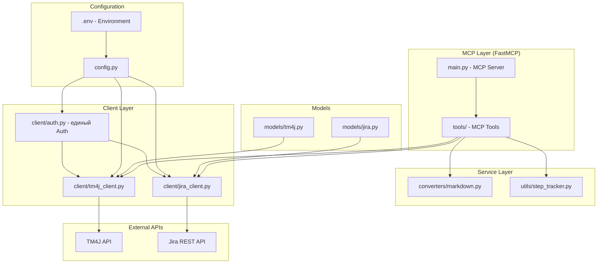
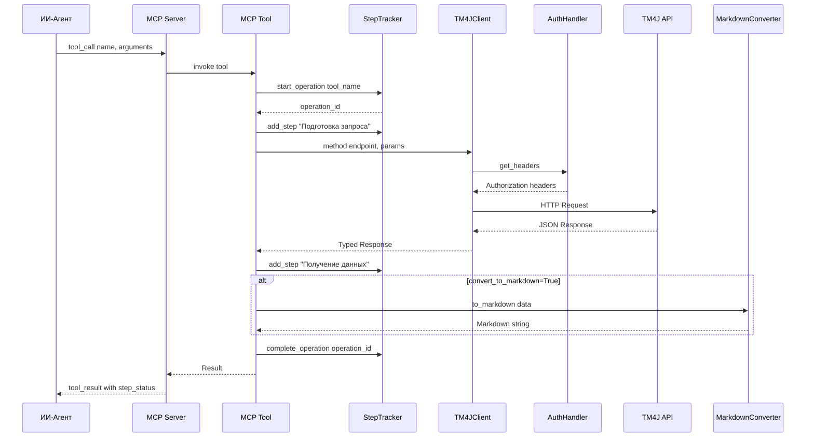

# Архитектура MCP-сервера TM4J (Zephyr Scale)

## 1. Обзор проекта

MCP-сервер на базе **FastMCP** (stdio-транспорт), предоставляющий ИИ-агенту полный доступ к API TM4J (Zephyr Scale for Jira). Сервер обеспечивает CRUD-операции над тест-кейсами, тест-планами, тест-прогонами, результатами выполнения, окружениями, папками, кастомными полями и проектами, а также составные представления с агрегацией данных.

---

## 2. Структура проекта

```
MCP_DefecTracker/
├── pyproject.toml               # Метаданные, зависимости, entry-points
├── uv.lock                      # Фиксация версий зависимостей
├── .env.example                 # Шаблон переменных окружения
├── README.md                    # Документация
├── plans/
│   └── architecture.md          # Этот файл
├── src/
│   ├── tm4j_mcp/
│   │   ├── __init__.py
│   │   ├── main.py              # Точка входа, запуск MCP-сервера (stdio)
│   │   ├── config.py            # Загрузка и валидация переменных окружения
│   │   ├── models/
│   │   │   ├── __init__.py
│   │   │   ├── tm4j.py          # Pydantic-модели сущностей TM4J
│   │   │   └── jira.py          # Модели для разрешения Jira-сущностей
│   │   ├── client/
│   │   │   ├── __init__.py
│   │   │   ├── auth.py          # Двойная схема авторизации (Basic + Bearer)
│   │   │   ├── tm4j_client.py   # HTTP-клиент для TM4J API
│   │   │   └── jira_client.py   # Клиент для Jira (разрешение владельца)
│   │   ├── converters/
│   │   │   ├── __init__.py
│   │   │   └── markdown.py      # Markdown-конвертер (автономный модуль)
│   │   ├── tools/
│   │   │   ├── __init__.py
│   │   │   ├── base.py          # Базовый класс MCP-инструмента с логированием шагов
│   │   │   ├── testcases.py     # Инструменты для /testcase
│   │   │   ├── testplans.py     # Инструменты для /testplan
│   │   │   ├── testruns.py      # Инструменты для /testrun
│   │   │   ├── testresults.py   # Инструменты для /testresult
│   │   │   ├── attachments.py   # Инструменты для /attachments
│   │   │   ├── folders.py       # Инструменты для /folder
│   │   │   ├── environments.py  # Инструменты для /environments
│   │   │   ├── projects.py      # Инструменты для /project
│   │   │   ├── customfields.py  # Инструменты для /customfield
│   │   │   ├── automation.py    # Инструменты для /automation/*
│   │   │   ├── executions.py    # Инструменты для /delete/executiondeletion
│   │   │   ├── composite.py     # Составные вью (composite views)
│   │   │   └── converter.py     # MCP-инструмент вызова Markdown-конвертера
│   │   └── utils/
│   │       ├── __init__.py
│   │       ├── step_tracker.py  # Трекер прогресса шагов для ИИ-агента
│   │       └── errors.py        # Централизованная обработка ошибок
│   └── prompts/
│       ├── system.md            # Системный промт для ИИ-агента
│       ├── tool_context.md      # Контекст работы с инструментами MCP
│       └── error_handling.md    # Промт по обработке ошибок
└── tests/
    ├── __init__.py
    ├── test_config.py
    ├── test_auth.py
    ├── test_tm4j_client.py
    ├── test_markdown_converter.py
    └── test_tools/
        ├── __init__.py
        ├── test_testcases.py
        └── test_composite.py
```

---

## 3. Переменные окружения

### 3.1 Обязательные

| Переменная | Описание | Пример |
|---|---|---|
| `TM4J_HOST` | URL-хост TM4J API (без trailing slash) | `https://example.atlassian.net` |
| `TM4J_AUTH_TYPE` | Тип авторизации: `basic` или `bearer` | `bearer` |
| `TM4J_PROJECT_KEY` | Жёстко зафиксированный ключ проекта | `PROJ` |
| `TM4J_OWNER` | Жёстко зафиксированный владелец (account_id или email) | `5b10a2844f25c16c440aef95` |

### 3.2 Для Basic Auth

| Переменная | Описание | Пример |
|---|---|---|
| `TM4J_BASIC_USER` | Email пользователя Jira | `user@example.com` |
| `TM4J_BASIC_PASSWORD` | API Token Jira | `ATATT3xFfDU...` |

### 3.3 Для Bearer Auth

| Переменная | Описание | Пример |
|---|---|---|
| `TM4J_BEARER_TOKEN` | Bearer-токен | `eyJhbGciOi...` |

### 3.4 Jira Integration

Jira-клиент для разрешения владельца **использует те же параметры авторизации**, что и TM4J-клиент. Дублирование переменных не требуется — единственная точка конфигурации. Опционально можно указать отдельный хост, если Jira развёрнута на другом URL.

| Переменная | Описание | По умолчанию |
|---|---|---|
| `JIRA_HOST` | URL-хост Jira API (если отличается от TM4J) | `TM4J_HOST` |

### 3.5 Опциональные

| Переменная | Описание | По умолчанию |
|---|---|---|
| `TM4J_API_BASE_PATH` | Базовый путь к API TM4J | `/rest/atmosphere/public/latest` |
| `HTTP_TIMEOUT` | Таймаут HTTP-запросов (сек) | `30` |
| `HTTP_RETRIES` | Количество повторов при сбое | `3` |
| `LOG_LEVEL` | Уровень логирования | `INFO` |

### 3.6 Шаблон `.env.example`

```env
# === TM4J / Jira Configuration (единые credentials) ===
TM4J_HOST=https://example.atlassian.net
TM4J_API_BASE_PATH=/rest/atmosphere/public/latest
TM4J_AUTH_TYPE=bearer
TM4J_BEARER_TOKEN=your_token_here
# TM4J_BASIC_USER=user@example.com
# TM4J_BASIC_PASSWORD=your_api_token_here
TM4J_PROJECT_KEY=PROJ
TM4J_OWNER=5b10a2844f25c16c440aef95

# Jira использует те же credentials.
# Указывайте JIRA_HOST только если Jira на другом хосте.
# JIRA_HOST=https://other-jira.example.com

# === HTTP ===
HTTP_TIMEOUT=30
HTTP_RETRIES=3

# === Logging ===
LOG_LEVEL=INFO
```

---

## 4. Архитектура модулей

### 4.1 Диаграмма модулей



### 4.2 Потоки данных



---

## 5. Модуль авторизации

### 5.1 Двойная схема (`client/auth.py`)

```python
# Псевдокод-схема модуля
class AuthConfig:
    """Единая конфигурация авторизации для TM4J и Jira."""
    auth_type: Literal["basic", "bearer"]
    # Basic
    basic_user: str | None
    basic_password: str | None
    # Bearer
    bearer_token: str | None

class AuthHandler:
    def __init__(self, config: AppConfig)
        # Один экземпляр на весь сервер — используется и TM4J, и Jira клиентами
    def get_headers(self) -> dict[str, str]
        # Basic: Authorization: Basic base64(user:password)
        # Bearer: Authorization: Bearer <token>
    def refresh_headers(self) -> dict[str, str]  # Для поддержки ротации токенов
```

### 5.2 Безопасность

- Токены **никогда** не логируются и не попадают в ответы MCP.
- Хранение только в памяти при загрузке из `os.environ`.
- Валидация при старте сервера: отсутствие обязательных параметров останавливает запуск.

---

## 6. Модуль Markdown-конвертера

### 6.1 Архитектура (`converters/markdown.py`)

Автономный модуль без зависимостей от HTTP-клиента. Принимает сериализованные Pydantic-модели или `dict` и возвращает Markdown-строку.

```python
class MarkdownConverter:
    """Преобразует TM4J-сущности в Markdown."""

    def convert(self, data: dict | list[dict], entity_type: str, indent: int = 0) -> str
    def test_case_to_md(self, tc: dict) -> str
    def test_run_to_md(self, tr: dict) -> str
    def test_result_to_md(self, tr: dict) -> str
    def test_plan_to_md(self, tp: dict) -> str
    def search_results_to_md(self, results: list[dict], entity_type: str) -> str
    def custom_fields_to_md(self, fields: list[dict]) -> str
    def environment_to_md(self, env: dict) -> str
    def folder_to_md(self, folder: dict) -> str
    def error_to_md(self, error: MCPErrors) -> str
```

### 6.2 Формат вывода

Каждая сущность конвертируется в структурированный Markdown:

- Заголовок с ключом/названием
- Таблица атрибутов (ключ-значение)
- Вложенные шаги/суб-сущности как нумерованные списки
- Кастомные поля выделены отдельной секцией

### 6.3 Интеграция с инструментами

Каждый MCP-инструмент принимает опциональный параметр `convert_to_markdown: bool = False`. При `True` результат передаётся через `MarkdownConverter.convert()`.

Отдельный MCP-инструмент `convert_response_to_markdown` позволяет конвертировать любой предыдущий ответ.

---

## 7. Трекер шагов для ИИ-агента

### 7.1 `utils/step_tracker.py`

Каждый MCP-инструмент с составными операциями делится на шаги. После каждого шага агент получает промежуточный статус.

```python
class StepStatus(str, Enum):
    PENDING = "pending"
    IN_PROGRESS = "in_progress"
    COMPLETED = "completed"
    FAILED = "failed"

class OperationContext:
    operation_id: str
    tool_name: str
    steps: list[StepRecord]
    overall_status: StepStatus

class StepRecord:
    step_id: int
    description: str
    status: StepStatus
    result_summary: str | None
    error: str | None
    started_at: datetime
    completed_at: datetime | None

class StepTracker:
    def start_operation(self, tool_name: str) -> str
    def add_step(self, operation_id: str, description: str) -> None
    def update_step(self, operation_id: str, step_id: int, status: StepStatus, result_summary: str = None, error: str = None) -> None
    def get_operation_status(self, operation_id: str) -> OperationContext
    def complete_operation(self, operation_id: str) -> OperationContext
```

### 7.2 Формат ответа для ИИ-агента

```json
{
  "data": { "...": "result data" },
  "step_status": {
    "operation_id": "op_123",
    "tool_name": "get_test_case_details",
    "overall_status": "completed",
    "steps": [
      {"step_id": 1, "description": "Загрузка тест-кейса", "status": "completed"},
      {"step_id": 2, "description": "Загрузка кастомных полей", "status": "completed"},
      {"step_id": 3, "description": "Конвертация в Markdown", "status": "completed"}
    ]
  }
}
```

---

## 8. Модели данных

### 8.1 TM4J Модели (`models/tm4j.py`)

Полная Pydantic-типизация всех сущностей из Swagger-спецификации:

```python
class ScriptStep(BaseModel):
    index: int
    description: str | None = None
    test_data: str | None = None
    expected_result: str | None = None

class TestScript(BaseModel):
    type: str
    text: str | None = None
    steps: list[ScriptStep] | None = None

class TestCase(BaseModel):
    key: str
    project_key: str  # JSON-совместимое именование
    name: str
    objective: str | None = None
    precondition: str | None = None
    folder: str | None = None
    status: str
    priority: str
    component: str | None = None
    owner: str | None = None
    estimated_time: int | None = None
    labels: list[str] | None = None
    test_script: TestScript
    custom_fields: dict[str, Any] | None = None  # Кастомные поля

class ScriptResult(BaseModel):
    index: int
    status: str
    comment: str | None = None

class TestResult(BaseModel):
    project_key: str
    test_case_key: str
    status: str | None = None
    environment: str | None = None
    comment: str | None = None
    user_key: str | None = None
    execution_time: int | None = None
    execution_date: str | None = None
    script_results: list[ScriptResult] | None = None
```

Аналогично для: `TestRun`, `TestPlan`, `Folder`, `Environment`, `Project`, `CustomField`, `CustomFieldOption`, `ExecutionDeletion`.

### 8.2 Jira Модели (`models/jira.py`)

```python
class JiraUser(BaseModel):
    account_id: str | None = None
    email_address: str | None = None
    display_name: str | None = None
    key: str | None = None

class JiraIssue(BaseModel):
    key: str
    fields: dict[str, Any]
```

---

## 9. API-клиент TM4J

### 9.1 `client/tm4j_client.py`

```python
class TM4JClient:
    def __init__(self, config: AppConfig, auth: AuthHandler)
    
    # === Test Cases ===
    def create_test_case(self, body: TestCase) -> TestCase
    def get_test_case(self, test_case_key: str, fields: str | None = None) -> TestCase
    def update_test_case(self, test_case_key: str, body: TestCase) -> TestCase
    def delete_test_case(self, test_case_key: str) -> None
    def search_test_cases(self, query: str, fields: str | None = None, start_at: int = 0, max_results: int = 50) -> dict
    def get_test_case_attachments(self, test_case_key: str) -> list
    def upload_test_case_attachment(self, test_case_key: str, file: bytes, filename: str) -> dict
    def get_step_attachments(self, test_case_key: str, step_index: int) -> list
    def upload_step_attachment(self, test_case_key: str, step_index: int, file: bytes, filename: str) -> dict
    def get_latest_test_result(self, test_case_key: str) -> TestResult

    # === Test Plans ===
    def create_test_plan(self, body: str) -> dict
    def get_test_plan(self, test_plan_key: str, fields: str | None = None) -> dict
    def update_test_plan(self, test_plan_key: str, body: str) -> dict
    def delete_test_plan(self, test_plan_key: str) -> None
    def search_test_plans(self, query: str, fields: str | None = None, start_at: int = 0, max_results: int = 50) -> dict
    def get_test_plan_attachments(self, test_plan_key: str) -> list
    def upload_test_plan_attachment(self, test_plan_key: str, file: bytes, filename: str) -> dict

    # === Test Runs ===
    def create_test_run(self, body: TestRun) -> TestRun
    def get_test_run(self, test_run_key: str, fields: str | None = None) -> TestRun
    def delete_test_run(self, test_run_key: str) -> None
    def search_test_runs(self, query: str, fields: str | None = None, start_at: int = 0, max_results: int = 50) -> dict
    def get_test_run_attachments(self, test_run_key: str) -> list
    def upload_test_run_attachment(self, test_run_key: str, file: bytes, filename: str) -> dict

    # === Test Results ===
    def create_test_result(self, body: TestResult) -> TestResult
    def create_test_result_for_run(self, test_run_key: str, test_case_key: str, body: dict, environment: str, user_key: str) -> dict
    def update_test_result_for_run(self, test_run_key: str, test_case_key: str, body: dict, environment: str, user_key: str) -> dict
    def bulk_create_test_results(self, test_run_key: str, body: dict, environment: str, user_key: str) -> dict
    def get_test_results(self, test_run_key: str) -> list
    def get_test_result_attachments(self, test_result_id: int) -> list
    def upload_test_result_attachment(self, test_result_id: int, file: bytes, filename: str) -> dict
    def get_result_step_attachments(self, test_result_id: int, step_index: int) -> list
    def upload_result_step_attachment(self, test_result_id: int, step_index: int, file: bytes, filename: str) -> dict

    # === Issue Links ===
    def get_test_cases_for_issue(self, issue_key: str, fields: str | None = None) -> list

    # === Folders ===
    def create_folder(self, body: Folder) -> Folder
    def update_folder(self, folder_id: int, body: Folder) -> Folder

    # === Environments ===
    def get_environments(self, project_key: str) -> list
    def create_environment(self, body: Environment) -> Environment

    # === Projects ===
    def create_project(self, body: Project) -> Project

    # === Custom Fields ===
    def create_custom_field(self, body: CustomField) -> CustomField
    def create_custom_field_option(self, custom_field_id: str, body: CustomFieldOption) -> CustomFieldOption

    # === Automation ===
    def import_automation_results(self, project_key: str, file: bytes, filename: str, test_cycle: str | None = None) -> dict
    def import_cucumber_results(self, project_key: str, file: bytes, filename: str, test_cycle: str | None = None) -> dict
    def get_automation_test_cases(self, tql: str) -> list

    # === Executions Deletion ===
    def delete_executions(self, body: ExecutionDeletion) -> dict
    def get_deletion_status(self) -> dict
    def cancel_deletion(self) -> dict

    # === Attachments ===
    def delete_attachment(self, attachment_id: str) -> None
```

### 9.2 Обработка ответов

- Автоматический парсинг JSON в Pydantic-модели.
- Поддержка полевой проекции через параметр `fields`.
- Пагинация через `startAt`/`maxResults`.
- Автоматическое повторение при 429/5xx (с экспоненциальной задержкой).

---

## 10. Jira-клиент для разрешения владельца

### 10.1 `client/jira_client.py`

Единый метод разрешения владельца по `jira_id` (issue key, user key, email или account_id):

```python
class JiraClient:
    """
    Jira REST API клиент для разрешения владельцев.
    Использует те же credentials, что и TM4J-клиент (единый AuthHandler).
    """
    def __init__(self, config: AppConfig, auth: AuthHandler)
        # Базовый URL берётся из config.effective_jira_host (jira_host или tm4j_host)
    
    def resolve_owner(self, identifier: str) -> str
        """
        Разрешает identifier в account_id владельца.
        
        Поддерживаемые форматы:
        - "PROJ-123" — берём fields.creator/assignee из задачи
        - "user@example.com" — lookup по email через /rest/api/2/user/search
        - "5b10a284..." — напрямую account_id
        - "USER" — lookup по key
        
        Возвращает: account_id строку
        """
    
    def search_user(self, query: str) -> list[JiraUser]
    def get_issue(self, issue_key: str, fields: str | None = None) -> JiraIssue
```

### 10.2 Логика разрешения

1. Если `identifier` совпадает с паттерном `^[A-Z]+-\d+$` — это Jira Issue Key:
   - GET `/rest/api/2/issue/{issue_key}?fields=creator,assignee`
   - Возвращаем `account_id` из `fields.creator` или `fields.assignee`
2. Если `identifier` содержит `@` — это email:
   - GET `/rest/api/2/user/search?query={email}`
   - Возвращаем `account_id` первого результата
3. Если `identifier` — 32-символьный hex — это account_id:
   - Возвращаем напрямую
4. Иначе — lookup по key:
   - GET `/rest/api/2/user?accountId={identifier}` или `/rest/api/2/user/search?query={identifier}`

---

## 11. MCP-инструменты

### 11.1 Классификация

| Категория | Эндпоинты | Файл |
|---|---|---|
| Test Cases | `/testcase`, `/testcase/search`, `/testcase/{key}`, `/testcase/{key}/testresult/latest`, `/testcase/{key}/attachments`, `/testcase/{key}/step/{idx}/attachments` | `tools/testcases.py` |
| Test Plans | `/testplan`, `/testplan/search`, `/testplan/{key}`, `/testplan/{key}/attachments` | `tools/testplans.py` |
| Test Runs | `/testrun`, `/testrun/search`, `/testrun/{key}`, `/testrun/{key}/attachments` | `tools/testruns.py` |
| Test Results | `/testresult`, `/testrun/{key}/testcase/{key}/testresult`, `/testrun/{key}/testresults`, `/testresult/{id}/attachments`, `/testresult/{id}/step/{idx}/attachments` | `tools/testresults.py` |
| Issue Links | `/issuelink/{key}/testcases` | `tools/testcases.py` |
| Folders | `/folder`, `/folder/{id}` | `tools/folders.py` |
| Environments | `/environments` | `tools/environments.py` |
| Projects | `/project` | `tools/projects.py` |
| Custom Fields | `/customfield`, `/customfield/{id}/option` | `tools/customfields.py` |
| Automation | `/automation/execution/{key}`, `/automation/execution/cucumber/{key}`, `/automation/testcases` | `tools/automation.py` |
| Execution Deletion | `/delete/executiondeletion`, `.../status`, `.../cancel` | `tools/executions.py` |
| Attachments | `/attachments/{id}` | `tools/attachments.py` |
| Composite | Составные вью | `tools/composite.py` |
| Converter | Markdown-конвертер | `tools/converter.py` |

### 11.2 Базовый класс инструмента (`tools/base.py`)

```python
class BaseTool:
    client: TM4JClient
    jira_client: JiraClient
    config: AppConfig
    converter: MarkdownConverter
    step_tracker: StepTracker
    
    def __init__(self, client: TM4JClient, jira_client: JiraClient, config: AppConfig)
    
    def response_wrapper(self, data: Any, convert_to_markdown: bool = False, entity_type: str = "") -> dict
        """Упаковывает ответ с step_status и опциональным Markdown."""
    
    def resolve_owner(self, owner_hint: str | None = None) -> str
        """Разрешает владельца: owner_hint -> Jira lookup -> config.TM4J_OWNER."""
```

### 11.3 Пример инструмента (`tools/testcases.py`)

```python
# Псевдокод
@mcp.tool()
async def get_test_case(test_case_key: str, fields: str | None = None, convert_to_markdown: bool = False) -> dict:
    """Получить тест-кейс по ключу с кастомными полями."""
    op = step_tracker.start_operation("get_test_case")
    
    try:
        step_tracker.add_step(op, "Загрузка тест-кейса")
        tc = client.get_test_case(test_case_key, fields)
        step_tracker.update_step(op, 1, "completed", f"Получен TC {tc.key}")
        
        step_tracker.add_step(op, "Загрузка кастомных полей")
        cf = client.get_custom_fields_for_entity(tc)  # Авто-подтягивание
        tc.custom_fields = cf
        step_tracker.update_step(op, 2, "completed")
        
        step_tracker.add_step(op, "Загрузка последнего результата")
        latest = client.get_latest_test_result(test_case_key)
        step_tracker.update_step(op, 3, "completed")
        
        result = {"test_case": tc.model_dump(), "latest_result": latest.model_dump() if latest else None}
        return base.response_wrapper(result, convert_to_markdown, "test_case")
    except Exception as e:
        step_tracker.update_step(op, 1, "failed", error=str(e))
        raise MCPError(code="TM4J_ERROR", message=str(e))
```

---

## 12. Составные вью (Composite Views)

### 12.1 `get_test_case_full_details`

Агрегирует в одном вызове:
1. Тест-кейс с шагами (`GET /testcase/{key}`)
2. Кастомные поля проекта (`POST /customfield` — получение списка)
3. Последний результат выполнения (`GET /testcase/{key}/testresult/latest`)
4. Вложения тест-кейса (`GET /testcase/{key}/attachments`)
5. Вложения по шагам (итерация по `testScript.steps`)

### 12.2 `get_test_run_full_details`

Агрегирует:
1. Тест-прогон со списком включённых тест-кейсов (`GET /testrun/{key}`)
2. Результаты выполнения всех тест-кейсов (`GET /testrun/{key}/testresults`)
3. Для каждого результата — статус шагов
4. Вложения тест-прогона
5. Статистика: общее количество, PASSED/FAILED/BLOCKED/SKIPPED

### 12.3 `get_test_plan_with_runs`

Агрегирует:
1. Тест-план (`GET /testplan/{key}`)
2. Связанные тест-прогоны (через `search_test_runs` с фильтром)
3. Статус каждого прогона

### 12.4 `search_and_execute_test_results`

Интерактивный сценарий для ИИ-агента:
1. Поиск тест-кейсов (`search_test_cases`)
2. Для каждого найденного — получение последнего результата
3. Агрегация статистики
4. Опционально — запись новых результатов

### 12.5 `get_project_test_overview`

Полный обзор тестирования проекта:
1. Все окружения проекта
2. Все папки
3. Все кастомные поля с опциями
4. Сводная статистика по тест-прогонaм
5. Активные тест-планы

---

## 13. Работа с кастомными полями

### 13.1 Автоматическое подтягивание

При получении сущности (test case, test run и т.д.) система автоматически:
1. Загружает схему кастомных полей проекта через `/customfield`
2. Сопоставляет значения из ответа API со схемой
3. Валидирует типы данных:
   - `text` → `str`
   - `number` → `int` | `float`
   - `date` → `str` (ISO 8601)
   - `select` → проверка на допустимые опции
   - `multiSelect` → `list[str]` с проверкой
   - `truefalse` → `bool`
   - `user` → `str` (account_id)
4. Проверяет обязательность (`required: true`): если поле не заполнено — добавляет warning в ответ

### 13.2 Модель кастомного поля

```python
class CustomField(BaseModel):
    project_key: str
    name: str
    description: str | None = None
    required: bool = False
    type: str  # text, number, date, select, multiSelect, truefalse, user, customstatus
    category: str
    options: list[CustomFieldOption] | None = None
    custom_statuses: list[str] | None = None  # Для типа customstatus
```

### 13.3 Кастомные статусы

Для полей типа `customstatus` система:
1. Получает доступные статусы из схемы поля
2. Валидирует переданные значения
3. Подсвечивает в Markdown-выводе недоступные статусы

---

## 14. Обработка ошибок

### 14.1 `utils/errors.py`

```python
class MCPError(Exception):
    code: str
    message: str
    recoverable: bool = False
    suggestion: str | None = None

class TM4JAPIError(MCPError):
    """Ошибка от TM4J API."""
    http_status: int
    response_body: str | None = None

class AuthError(MCPError):
    """Ошибка авторизации."""

class ValidationError(MCPError):
    """Ошибка валидации входных данных."""

class JiraResolutionError(MCPError):
    """Ошибка разрешения владельца через Jira."""
    original_identifier: str
```

### 14.2 Маппинг HTTP-статусов

| HTTP Status | MCP Error Code | Поведение |
|---|---|---|
| 400 | `VALIDATION_ERROR` | Валидация входных данных |
| 401 | `AUTH_ERROR` | Переавторизация |
| 403 | `FORBIDDEN` | Не хватает прав |
| 404 | `NOT_FOUND` | Сущность не найдена |
| 409 | `CONFLICT` | Конфликт данных |
| 429 | `RATE_LIMIT` | Retry с backoff |
| 5xx | `SERVER_ERROR` | Retry с backoff |

### 14.3 Стратегия повторений

```python
@retry(
    stop=stop_after_attempt(3),
    wait=wait_exponential(multiplier=1, min=2, max=30),
    retry=retry_if_exception_type((TM4JAPIError, ConnectionError))
)
def _request(self, method: str, url: str, **kwargs) -> Response:
    ...
```

---

## 15. Конфигурация и инициализация

### 15.1 `config.py`

```python
class AppConfig(BaseSettings):
    # TM4J / Jira — единые credentials
    tm4j_host: str
    tm4j_api_base_path: str = "/rest/atmosphere/public/latest"
    tm4j_auth_type: Literal["basic", "bearer"]
    tm4j_basic_user: str | None = None
    tm4j_basic_password: str | None = None
    tm4j_bearer_token: str | None = None
    tm4j_project_key: str
    tm4j_owner: str
    
    # Jira хост — опционально, по умолчанию берётся TM4J_HOST
    jira_host: str | None = None
    
    @property
    def effective_jira_host(self) -> str:
        return self.jira_host or self.tm4j_host
    
    # HTTP
    http_timeout: int = 30
    http_retries: int = 3
    
    # Logging
    log_level: str = "INFO"
    
    model_config = SettingsConfigDict(env_file=".env", env_file_encoding="utf-8", case_sensitive=True)
    
    def validate(self) -> None:
        if self.tm4j_auth_type == "basic":
            if not self.tm4j_basic_user or not self.tm4j_basic_password:
                raise ValueError("Basic auth требует TM4J_BASIC_USER и TM4J_BASIC_PASSWORD")
        elif self.tm4j_auth_type == "bearer":
            if not self.tm4j_bearer_token:
                raise ValueError("Bearer auth требует TM4J_BEARER_TOKEN")
```

### 15.2 `main.py` — точка входа

```python
from fastmcp import FastMCP
from .config import AppConfig
from .client.auth import AuthHandler
from .client.tm4j_client import TM4JClient
from .client.jira_client import JiraClient
from .tools import register_all_tools

def main():
    config = AppConfig()
    config.validate()
    
    # Единый AuthHandler — одни credentials для TM4J и Jira
    auth = AuthHandler(config=config)
    
    tm4j_client = TM4JClient(config=config, auth=auth)
    jira_client = JiraClient(config=config, auth=auth)
    
    mcp = FastMCP(
        name="tm4j-mcp-server",
        version="1.0.0",
        instructions="MCP-сервер для работы с TM4J (Zephyr Scale) API"
    )
    
    register_all_tools(mcp, tm4j_client, jira_client, config)
    mcp.run(transport="stdio")

if __name__ == "__main__":
    main()
```

---

## 16. Промты для ИИ-агента

### 16.1 Системный промт (`prompts/system.md`)

```markdown
# TM4J MCP Server — Системный промт

Ты взаимодействуешь с TM4J (Zephyr Scale) API через MCP-сервер. 
Проект: {TM4J_PROJECT_KEY}, Владелец: {TM4J_OWNER}.

## Основные возможности
- Управление тест-кейсами (создание, чтение, обновление, удаление, поиск)
- Управление тест-планами и тест-прогонами
- Запись и чтение результатов выполнения тестов
- Работа с вложениями, окружениями, папками
- Кастомные поля с валидацией типов и обязательности
- Импорт результатов автоматизации (JUnit, Cucumber)
- Составные представления с агрегацией данных

## Правила работы
1. Всегда указывай `convert_to_markdown=true` для удобного чтения результатов
2. При создании сущностей используй системного владельца из контекста
3. При указании owner используй `resolve_owner` для определения account_id
4. Проверяй `step_status` в ответах для контроля прогресса
5. При ошибках используй `error.code` для определения стратегии восстановления
```

### 16.2 Контекст инструментов (`prompts/tool_context.md`)

```markdown
# Форматы вызовов MCP-инструментов

## Паттерн вызова
```
tool_call: {
  "name": "get_test_case",
  "arguments": {
    "test_case_key": "PROJ-123",
    "fields": "key,name,status,priority,testScript,customFields",
    "convert_to_markdown": true
  }
}
```

## Параметр convert_to_markdown
При `true` ответ содержит `markdown` поле с отформатированным выводом.

## Параметр fields
Комма-разделённый список полей для оптимизации объёма ответа.
Доступные поля зависят от сущности (смотри документацию инструмента).

## Разрешение владельца
```
tool_call: {
  "name": "resolve_owner",
  "arguments": { "identifier": "PROJ-456" }
}
```
Возвращает `account_id` для использования в `owner` или `userKey`.
```

### 16.3 Обработка ошибок (`prompts/error_handling.md`)

```markdown
# Обработка ошибок

## Коды ошибок и стратегии

| Код | Описание | Действие |
|---|---|---|
| VALIDATION_ERROR | Неверные входные данные | Исправь параметры и повтори |
| AUTH_ERROR | Проблема авторизации | Перезапусти MCP-сервер с новыми credentials |
| FORBIDDEN | Недостаточно прав | Обратись к администратору |
| NOT_FOUND | Сущность не найдена | Проверь ключ/ID, используй search |
| CONFLICT | Конфликт данных | Проверь уникальность, пересмотри данные |
| RATE_LIMIT | Лимит запросов | Подожди и повтори (автоматический retry) |
| SERVER_ERROR | Ошибка сервера | Повтори запрос (автоматический retry) |
| JIRA_RESOLUTION_ERROR | Не удалось разрешить владельца | Проверь identifier, используй прямой account_id |

## Статусы выполнения шагов
Поле `step_status` в ответе показывает прогресс:
- `pending` — шаг ожидает выполнения
- `in_progress` — шаг выполняется
- `completed` — шаг завершён успешно
- `failed` — шаг завершён с ошибкой

При `overall_status: failed` проверь `steps[].error` для диагностики.
```

---

## 17. pyproject.toml

```toml
[project]
name = "tm4j-mcp-server"
version = "1.0.0"
description = "MCP-сервер для TM4J (Zephyr Scale) API"
requires-python = ">=3.11"
dependencies = [
    "fastmcp>=2.0.0",
    "httpx>=0.27.0",
    "pydantic>=2.0.0",
    "pydantic-settings>=2.0.0",
    "tenacity>=8.0.0",
    "python-dotenv>=1.0.0",
]

[project.optional-dependencies]
dev = [
    "pytest>=8.0.0",
    "pytest-asyncio>=0.23.0",
    "pytest-cov>=4.0.0",
    "ruff>=0.4.0",
    "mypy>=1.0.0",
]

[project.scripts]
tm4j-mcp = "tm4j_mcp.main:main"

[build-system]
requires = ["hatchling"]
build-backend = "hatchling.build"

[tool.uv]
dev-dependencies = []

[tool.ruff]
target-version = "py311"
line-length = 120

[tool.pytest.ini_options]
testpaths = ["tests"]
asyncio_mode = "auto"

[tool.mypy]
python_version = "3.11"
strict = true
```

---

## 18. Маршрутизация MCP-инструментов → API Эндпоинты

| MCP Tool | API Method | API Path | Auth |
|---|---|---|---|
| `create_test_case` | POST | `/testcase` | ✅ |
| `get_test_case` | GET | `/testcase/{key}` | ✅ |
| `update_test_case` | PUT | `/testcase/{key}` | ✅ |
| `delete_test_case` | DELETE | `/testcase/{key}` | ✅ |
| `search_test_cases` | GET | `/testcase/search` | ✅ |
| `get_test_case_attachments` | GET | `/testcase/{key}/attachments` | ✅ |
| `upload_test_case_attachment` | POST | `/testcase/{key}/attachments` | ✅ |
| `get_step_attachments` | GET | `/testcase/{key}/step/{idx}/attachments` | ✅ |
| `upload_step_attachment` | POST | `/testcase/{key}/step/{idx}/attachments` | ✅ |
| `get_latest_test_result` | GET | `/testcase/{key}/testresult/latest` | ✅ |
| `create_test_plan` | POST | `/testplan` | ✅ |
| `get_test_plan` | GET | `/testplan/{key}` | ✅ |
| `update_test_plan` | PUT | `/testplan/{key}` | ✅ |
| `delete_test_plan` | DELETE | `/testplan/{key}` | ✅ |
| `search_test_plans` | GET | `/testplan/search` | ✅ |
| `get_test_plan_attachments` | GET | `/testplan/{key}/attachments` | ✅ |
| `upload_test_plan_attachment` | POST | `/testplan/{key}/attachments` | ✅ |
| `create_test_run` | POST | `/testrun` | ❌ |
| `get_test_run` | GET | `/testrun/{key}` | ✅ |
| `delete_test_run` | DELETE | `/testrun/{key}` | ✅ |
| `search_test_runs` | GET | `/testrun/search` | ✅ |
| `get_test_run_attachments` | GET | `/testrun/{key}/attachments` | ✅ |
| `upload_test_run_attachment` | POST | `/testrun/{key}/attachments` | ✅ |
| `create_test_result` | POST | `/testresult` | ✅ |
| `create_test_result_for_run` | POST | `/testrun/{run}/testcase/{tc}/testresult` | ✅ |
| `update_test_result_for_run` | PUT | `/testrun/{run}/testcase/{tc}/testresult` | ✅ |
| `bulk_create_test_results` | POST | `/testrun/{key}/testresults` | ✅ |
| `get_test_results` | GET | `/testrun/{key}/testresults` | ✅ |
| `get_test_result_attachments` | GET | `/testresult/{id}/attachments` | ✅ |
| `upload_test_result_attachment` | POST | `/testresult/{id}/attachments` | ✅ |
| `get_result_step_attachments` | GET | `/testresult/{id}/step/{idx}/attachments` | ✅ |
| `upload_result_step_attachment` | POST | `/testresult/{id}/step/{idx}/attachments` | ✅ |
| `get_test_cases_for_issue` | GET | `/issuelink/{key}/testcases` | ✅ |
| `create_folder` | POST | `/folder` | ✅ |
| `update_folder` | PUT | `/folder/{id}` | ✅ |
| `delete_attachment` | DELETE | `/attachments/{id}` | ✅ |
| `get_environments` | GET | `/environments` | ✅ |
| `create_environment` | POST | `/environments` | ✅ |
| `create_project` | POST | `/project` | ✅ |
| `create_custom_field` | POST | `/customfield` | ✅ |
| `create_custom_field_option` | POST | `/customfield/{id}/option` | ✅ |
| `import_automation_results` | POST | `/automation/execution/{key}` | ✅ |
| `import_cucumber_results` | POST | `/automation/execution/cucumber/{key}` | ✅ |
| `get_automation_test_cases` | GET | `/automation/testcases` | ✅ |
| `delete_executions` | POST | `/delete/executiondeletion` | ✅ |
| `get_deletion_status` | GET | `/delete/executiondeletion/status` | ✅ |
| `cancel_deletion` | POST | `/delete/executiondeletion/cancel` | ✅ |
| `resolve_owner` | — | Jira API | ✅ |
| `convert_response_to_markdown` | — | Внутренний | ❌ |
| `get_test_case_full_details` | — | Composite | ✅ |
| `get_test_run_full_details` | — | Composite | ✅ |
| `get_test_plan_with_runs` | — | Composite | ✅ |
| `get_project_test_overview` | — | Composite | ✅ |

---

## 19. Запуск и подключение

### 19.1 Установка

```bash
uv venv
uv sync
```

### 19.2 Запуск MCP-сервера

```bash
# Через uv run
uv run tm4j-mcp

# Или напрямую
uv run python -m tm4j_mcp.main
```

### 19.3 Подключение из MCP-клиента

```json
{
  "mcpServers": {
    "tm4j": {
      "command": "uv",
      "args": ["run", "tm4j-mcp"],
      "env": {
        "TM4J_HOST": "https://example.atlassian.net",
        "TM4J_AUTH_TYPE": "bearer",
        "TM4J_BEARER_TOKEN": "...",
        "TM4J_PROJECT_KEY": "PROJ",
        "TM4J_OWNER": "..."
        # Jira автоматически использует те же credentials.
        # JIRA_HOST нужен только если Jira на другом хосте.
      }
    }
  }
}
```

---

## 20. Ключевые архитектурные решения

| Решение | Обоснование |
|---|---|
| **FastMCP + stdio** | Стандартный транспорт MCP, совместимость с Claude Desktop, Cursor, VS Code |
| **Двойная авторизация** | Гибкость: Basic для персональных токенов, Bearer для сервисных аккаунтов |
| **Модульный конвертер** | Автономность, тестируемость, возможность вызова из любого инструмента |
| **Составные вью** | Снижение числа вызовов от агента, агрегация в одном ответе |
| **StepTracker** | Прозрачность для ИИ-агента: видно на каком шаге остановилась операция |
| **Авто-подтягивание кастомных полей** | Агент не должен знать схему полей — сервер предоставляет её контекстно |
| **Разрешение владельца через Jira** | Единый метод без дублирования функционала Jira |
| **Жёсткая фиксация projectKey и owner** | Безопасность: агент не может переключить проект |
| **pydantic-settings + env** | Простая конфигурация, валидация при старте |
| **httpx + tenacity** | Асинхронный HTTP с автоматическими retry |
